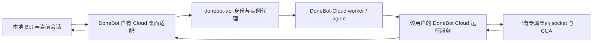

# DoneBot 自有云桌面与任务接力方案

状态：待授权的实现方案。已完成的代码仅为私有桌面前端入口屏蔽；本文描述的本地跨云桌面适配和任务接力尚未实现、部署或验收。

## 产品目标

- 本地 Bot 可以操作账号自己的 DoneBot Cloud 桌面，继续使用当前 Bot、会话和记忆。
- 用户无需切换到另一套 Cloud 工作空间才能使用云桌面。服务器列表中的 Cloud 工作空间连接仍然保留，已有两端数据不自动合并。
- 用户明确要求“关机后交给云端继续”时，转移任务执行权及所需资料；云端确认接管之后，本机才提示可以关闭。开机后把进度和产物回传原会话，用户可以要求接回。
- 不在本机安装独立 Linux 私有桌面；本地和 Cloud 均不再提供独立“私有桌面”产品选项。Cloud 自有桌面内部仍复用现有容器桌面实现。
- LLM 始终使用 DoneBot 统一网关；第三方媒体 CLI/MCP 的既有规则不变。

## 当前代码的实际能力

| 位置 | 已有能力 | 缺失部分 |
| --- | --- | --- |
| DoneBot `shared/wire.ts`、`server/index.ts` 的 computer provider | `cloud` 分为 Boat (`box`) 与自有 SSH VPS (`vps`)；本地引擎可通过 MCP 操作远程桌面 | 没有 DoneBot 自有账号云桌面 provider |
| DoneBot `server/cloud-desktop.ts`、`server/cloud-desktop-stdio.ts`、`server/container-computer.ts` | Cloud 运行服务通过专属 Unix socket 访问托管桌面，复用原版 VM 状态、截图、CUA MCP 和文件交付 | 仅在 Cloud 运行服务内部接入；不是可供本地 Bot 调用的公网协议 |
| DoneBot-Cloud `src/desktops.mjs` | 每实例一个受控桌面，按需启停、持久资料盘、截图、命令、文件、MCP 和查看通道 | 当前访问引用计数不是跨本地/云端的唯一操作权；不能直接认为已支持多运行服务共享控制 |
| DoneBot-Cloud `src/worker.mjs`、`src/agent.mjs` | 验证网关签名及运行租约，代理到指定用户运行服务；容器管理留在受信 agent | 需要为桌面访问复用这条受控链路，不能直接公开内部 socket |
| donebot-api `backend/internal/cloudbilling/proxy.go` | 登录身份、实例归属、订阅及节点检查，短期签名授权，HTTP/WS 代理和连接存续检查 | 没有专门的桌面访问契约 |
| donebot-api `backend/internal/cloudbilling/desktop.go` | `desktop-launch` 实际生成打开另一套 Cloud 工作空间的原生配对链接 | 它不是“给本地 Bot 一个云桌面”的接口，不应仅改名混用 |
| DoneBot `electron/cloud-send.mjs`、`server/cloud-send-*` | 分页传输、聊天/记忆/文件及附件校验、失败恢复 | 是迁移工具，不能原样用作频繁往返的任务同步 |
| DoneBot `server/bot-moves.ts`、`electron/bot-move-main.mjs` | 指定 Bot 迁移，暂停原端、校验后归档本地 Bot | 默认总协调 Bot 不允许这样迁走；不具备日常双向任务接回能力 |
| DoneBot `electron/own-home-main.mjs` | 一次性把自有服务器设为唯一 home，冻结本地工作空间，并借用本机能力 | 改变长期数据归属，不是当前需求中的临时任务接力，不自动启用 |

本次对照的是相邻三个仓库的源码；不把源码文档中的历史验证记录当作当前生产部署状态。

## 第一阶段：本地 Bot 操作自有云桌面



此阶段只改变工具执行位置，LLM 编排进程仍在本机。因此它本身不能保证关机后继续工作。

### DoneBot

1. 增加显式的 `donebot` cloud backend，保留原 `box`、`vps` 存量值的解析；不把 Boat 密钥、VPS SSH 配置解释成 DoneBot 云资源。
2. 在 `server/donebot/` 新建账号 Cloud 桌面适配，通过现有网关登录管理会话访问账号自己的实例。复用账号刷新与退出机制，安装用模型 key 不升级为 Cloud 管理权限。
3. 在原版 provider 接点接入适配：目标查询和选择、CUA 工具挂载、截图、查看、命令、桌面文件回传、占用释放及连接关闭。复用 `select_computer` 和既有安全审批；不给 LLM 一个任意公网代理或宿主 Docker 执行工具。
4. 面板“云端桌面”选择 DoneBot Cloud，不再展示 Boat 购买、连接密钥或原版计划文案。账号未开通、实例未启动、订阅到期分别展示真实状态；选择桌面不暗中购买服务。
5. 自动模式只列出实际可用位置；不列出本机私有桌面，也不经旧 VM 启动路径安装它。旧 `vm` 配置保留数据并提示改选，不静默切到用户真实屏幕。
6. 本地下载走服务器中转和原版附件验证，在原会话生成附件。查看器只接收应用自带页面与受控桌面字节流，不把网关 JWT 放进渲染页面、URL 或模型上下文。

### 桌面接口职责

在用户 Cloud 运行服务的 DoneBot 自有路由中提供版本化适配，复用网关现有实例代理。接口名是拟定契约，实现时一并固定类型与测试：

| 操作 | 契约 |
| --- | --- |
| 查询 | 桌面状态、是否可用、占用方及资源限制；不隐式安装或启动 |
| 确保就绪 | 在订阅有效且用户允许使用云桌面时，幂等启动已有固定桌面实现 |
| 操作权 | 申请、续期、释放独占控制租约；包含运行服务身份及递增代号 |
| 截图 | 有界图像读取；不改变控制权 |
| CUA MCP | 把已有 stdio MCP 桥封装进认证的 WebSocket，逐条检查操作权；不假定现有代理支持任意自定义 HTTP Upgrade |
| 命令 | 原版允许的桌面内执行，受同一控制权、审批和超时约束 |
| 查看/接管 | 复用原版查看器及控制语义；可输入的 RFB 连接必须绑定有效控制租约 |
| 文件 | 复用 workspace 路径约束、普通文件检查、大小上限、私有临时文件和原会话附件校验 |

不把内部 `/action` 的所有动作原样开放给客户端。镜像、挂载、容器参数、资料盘删除及宿主路径仍由受信 Cloud 管理；远程桌面接口不提供节点运维能力。

### 网关与 Cloud

- donebot-api 继续验证真实登录身份、实例归属、订阅和凭据有效性，转发桌面 HTTP/WS。请求中的用户 ID、运行端 ID 都不能替代服务端授权。
- 桌面控制会话与模型安装 key 分离。若增加受限桌面凭据，必须绑定用户、实例、用途及有效期，继承退出/撤销和订阅停机；不向第三方 CLI/MCP 交出它。
- DoneBot-Cloud 复用已有专属桌面和 Unix socket，不再创建第二套“私有桌面”，不向用户容器提供 Docker socket。
- 唯一桌面操作权在 Cloud 一侧统一维护。本地 Bot、Cloud Bot 和人工接管必须走同一门；原版各进程内的控制标志不能充当跨进程锁。
- 先支持多人看截图、单方交互；可输入的查看连接必须独占。不能只设置 noVNC 的前端只读参数就声称服务端已阻止输入。
- 订阅停机、租约到期、账号退出或撤销时拒绝新动作并结束现有工具/查看连接；不能因客户端断线而留下永久操作权。

## 第二阶段：关机前交接任务与开机接回

任务接力放在 DoneBot 运行服务，网关不接收语义需求、不选模型、不规划任务。DoneBot-Cloud 负责承载运行服务和桌面；donebot-api 仍只提供身份、实例路由和计费等基础功能。

### 交接记录

在该用户 Cloud 运行服务中持久化任务的执行归属和交接状态，本地保存对应恢复日志；不让两端共享或同时写一份数据库文件。最小记录包括：

- 交接 ID、逻辑 Bot/会话/任务 ID、来源安装标识、目标实例、幂等键；
- 当前执行端、执行代号、租约期限、交接状态及双方确认；
- 已确认的会话游标、必要上下文摘要、任务进度及待执行步骤；
- 文件清单、内容摘要、冲突版本及附件映射；
- 已提交媒体任务的回执、待处理审批和已知外部操作结果。

使用独立映射保留 Cloud 现有工作空间的数据，不能按同名 Bot 覆盖或合并。总协调 Bot 交出的是指定任务的执行权，不走默认 Bot 被禁止的永久迁移接口。

### 本地交给云端

1. 总协调 Bot 通过结构化工具发起交接，检查 Cloud 可用、凭据/工具/文件齐备，以及目标任务是否可离开本机。
2. 在工具步骤之间的安全点停止派发新动作，等在途动作完成或确认取消，形成可恢复检查点。不能复制一个仍在执行的 shell、浏览器或模型进程并宣称无缝迁移。
3. 复用现有分页、内容校验及冲突保留机制，只上传必要资料。不得直接复用会迁移全部密钥和自动化的完整 `move` 操作。
4. 云端校验资料，持久化准备结果。来源先持久化停止执行的承诺，目标再提交新的执行代号；开始工具调用前检查唯一归属。
5. 只有收到云端已提交且可查询的接管确认，客户端才显示“云端已接手，可以关闭电脑”。确认响应丢失时查询交接记录，不重复提交或自行恢复执行。
6. 云端使用自己的网关凭据继续任务，并把结果、进度和附件追加到此任务的事件记录。本机关闭不影响它查询已受理的媒体任务。

### 接回与故障恢复

- 开机后按游标增量取回事件、文件和附件，幂等写入原会话；接回必须先同步进度，再完成反向执行权交接。
- 不覆盖双方独立编辑；同路径内容不同时保留冲突版本。不同任务可以各自留在本地或云端，不因此迁走整个工作空间。
- 本地与 Cloud 的计划任务不会因复制配置而双跑；本阶段只转移所选任务。需要转移例行任务时单独记录调度归属。
- 租约失效不等于外部副作用已停止。无法确认在途操作结果时，状态应为待核对，不能让另一端立刻重新执行。
- 对支持幂等键的媒体/外部操作复用原回执；不支持幂等的发信、表单提交、桌面点击等不承诺恰好一次，更不能靠自动重试掩盖未知结果。
- 需要本机文件、应用、硬件或仅本机授权而无法转移的步骤应明确阻塞。Cloud 不绕过原版权限、审批及用户指定工作位置。
- 首版采用明确交接；突然关机只能从已确认检查点恢复，不承诺尚未上传的本地状态可恢复。

## 需要修改原版代码的具体接点

| 范围 | 必要原因及影响 |
| --- | --- |
| `shared/wire.ts` 的 cloud backend 与相关 provider 类型/解析 | 增加自有 Cloud 目标，保留旧配置解析；不能仅改 UI 标签 |
| `server/index.ts` 的目标查询、provider 选择、工具挂载及 computer API 接点 | 本地 Bot 才能实际调用云桌面；原版 Boat、VPS、本机、浏览器的机制继续复用 |
| `server/routes/desktop-viewer.ts`、`server/desktop-viewer-targets.ts` 及必要的桌面文件交付接点 | 受控远程查看、人工接管和原会话附件回传 |
| `server/surface.ts`、`server/agents-turn.ts` 与 `server/drivers/agents-call.ts` 的目标选择/调用接点 | 自然语言选择自有 Cloud，屏蔽私有桌面自动选择与启动；不重写模型引擎或原工具系统 |
| 原版任务派发、停止/恢复、持久化和会话追加接点 | 仅为第二阶段接入交接检查、执行代号和增量结果；新增逻辑尽量放独立 DoneBot 模块 |

上述范围需遵循根 `AGENTS.md` 先取得用户明确许可。已存在的 Cloud 内部受限桌面适配授权和 Electron 空间切换失败恢复授权，都不自动扩展为本方案授权。不修改企业功能、模型路由策略或其它无关原版机制。

## 验收与上线顺序

第一阶段先在合成账号、两套隔离 DoneBot 运行服务、模拟网关及一次性 Linux 桌面中验证：

- 本地原会话可选自有云桌面，截图、CUA 动作、人工接管及文件回传闭环；不需切换 Cloud 工作空间。
- 无本机私有桌面安装请求，无 Boat 连接/购买请求；本机控制、浏览器和自有 VPS 不回归。
- 两端竞争同一桌面时只有一方可操作；退出、撤销、订阅到期、断线及服务重启都能终止或恢复正确租约。
- 伪造实例、跨用户访问、过期会话、任意 URL/路径均被拒绝；桌面内容不能读取客户端管理凭据。

第二阶段另验证：

- 总协调 Bot 交出指定任务，本地停止后 Cloud 继续；开机后同一原会话能看到进度和附件，再接回继续。
- 在准备、上传、提交及确认丢失各点注入中断/重启，归属可查询、可恢复，两端不同时派发同一任务。
- 既有 Cloud 数据不被覆盖，分页聊天和文件冲突保留，自动化不双跑，已收费媒体任务不重提。
- Cloud 不可用、订阅终止、资料或本地依赖缺失时如实阻塞；状态不明的外部动作不被自动重做。

GUI、真实 CUA 容器、认证代理和关机持续执行需要分别记录证据。单元测试、模拟桌面或旧版本 Linux 验证记录不能替代本次跨端验收。通过隔离验收后再准备部署及打包结果供用户审阅。

## 本轮已完成验证

仅针对私有桌面的前端入口屏蔽：17 个相关测试文件，285 项测试通过；`pnpm lint`、`pnpm typecheck` 通过。隔离 `cloud-preview` fixture 验证旧 VM 配置和会话固定位置显示停用提示、设置页不出现私有桌面安装及 Boat 资源卡，同时保留自有 VPS 管理。没有对用户正在使用的应用或云实例做验证变更。

复现命令：

```sh
pnpm exec vitest run src/lib/place.test.ts src/components/ComputerPanel*.test.ts src/components/LocalComputerSection.test.ts src/components/PlaceChip*.test.ts src/components/BotSettingsDialog.simple.test.ts src/donebot/services.dom.test.ts src/components/FailedTurnRow.place.test.ts
pnpm lint
pnpm typecheck
node --experimental-strip-types scripts/verify-cloud-preview.ts
```

原版底层测试显式打开功能开关，以保留其原有生命周期和接管覆盖；产品停用状态另测。此次不声称后端已禁止 VM 工具或 Auto 路由；该部分属于上表待授权的原版调度接点。
